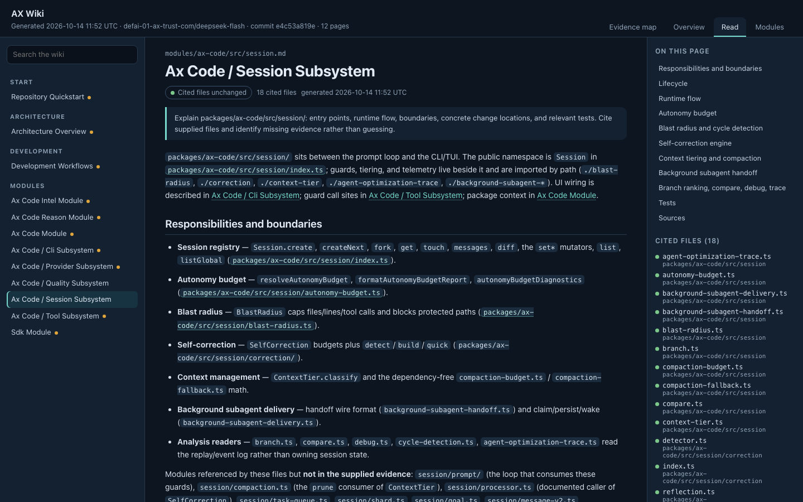
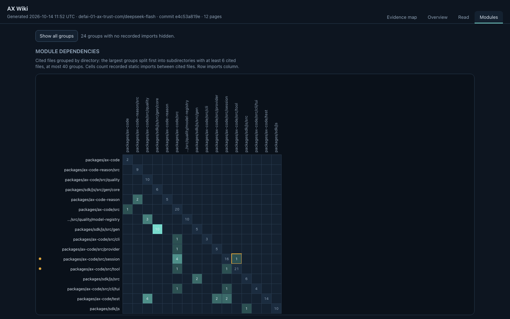

# View Wiki evidence in a browser

Status: Active

Scope: current-state

Last reviewed: 2026-10-15

Owner: ax-code runtime

Run this command from a project that already has an AX Wiki:

```sh
ax-code wiki viz
```

The command prints a local browser link and stays in the foreground. Click the
link to explore the recorded relationships between Wiki pages and their source
files. Use `--open` to launch the system browser automatically. Press Ctrl+C to
stop the local viewer.

## What you see

The viewer opens on the evidence map so you get the picture first, then lets you
read, check and navigate the wiki. These pictures are AX Code's own wiki.


**Evidence map.** Which files does each page cite, and which changed since the page
was written? The map opens as a treemap: each page is a block sized by the files it
cites, each cited file is one cell, changed files are outlined in amber and page
headers count them. Force and Radial redraw the same evidence as a network; lines
are recorded citations and static imports, not calls. Freshness chips count files
whose current bytes match (fresh) or differ from (stale) the hash recorded when the
page was written. Symbols are hidden until you turn them on or select one. Select a
page and use **Read this page** to open it.


**Overview.** Can I trust this wiki today? Start pages, the share of indexed files
that any page cites (citation coverage, not documentation quality), how many pages
have changed cited files, each page's freshness bar, the files most pages rely on,
and a coverage icicle by directory.



**Read.** The generated page, rendered without raw HTML. Search covers every page's
text. Cited paths in the text open a card that says who cites the file, whether it
changed, and jumps to it on the map. Related pages are ranked by shared cited files;
that is a list, never a drawn dependency.



**Modules.** How do the documented areas depend on each other? Cited files are grouped
by directory, and each cell counts recorded static imports (relative imports and
tsconfig `paths` aliases) between cited files. Rows are ordered providers first;
cycles are outlined in amber. A page-by-module heatmap shows which areas each page
cites.

At most 200 nodes and 500 relationships are drawn on the map, with omitted counts
shown; the reader, overview and module views use every page.

```sh
ax-code wiki viz --open
ax-code wiki viz --directory /path/to/project --dir .ax-wiki
ax-code wiki viz --export ./wiki-evidence.html
```

`--export` creates a self-contained HTML file that opens offline, without AX Code,
a server, or external assets. It refuses to overwrite an existing file. Its parent
directory must exist. `--open` and `--export` cannot be combined.

The map supports search, page/source filters, one-hop selection, evidence details,
and zoom/pan controls. The Explore list works with the keyboard: Tab to an item and
press Enter; Escape returns focus to search. Arrow keys move between the view tabs.
Map search covers the drawn snapshot; the reader's search covers every page.

The CLI view is a fixed snapshot of `.manifest.json` and the page files. It does not
generate a Wiki, run a model, reindex code, or automatically refresh. When the
snapshot is taken, cited files are hashed (without following symlinks) to decide
freshness, and cited source files are read for symbols and static imports; their
text is not included. Freshness is as of that moment.

The local link grants access to that snapshot until the process stops. The server
binds only to `127.0.0.1` and serves only the snapshot. Exported files contain page
titles, page text, relative source paths, recorded content hashes, the generation
model name and commit; review these before sharing. No source text, absolute project
root, or credentials are exported.

## Open from the TUI

In a session, use **Wiki graph** near the project path at the bottom of the
right sidebar, or enter `/wiki-viz`. The same action is available in the command
palette when the sidebar is hidden. It opens the system browser; if that fails,
a dialog offers the local link for copying and a retry action.

The browser opens immediately, including when the project has no Wiki yet. It shows
waiting, generation progress or failure and loads the page/source graph when a
snapshot is available. Opening the graph requests generation or incremental update;
it skips the normal idle delay but waits for active sessions, queued work and a
nonempty TUI draft. A failed browser launch offers a copyable link.

Interactive AX Code enables background Wiki maintenance by default. After 30 seconds
of quiet, it generates a missing Wiki or updates stale artifacts. It uses the configured
Wiki model (or AX Code's default model), source and page budgets, and current agent
read/write permissions. Foreground work cancels maintenance; incomplete builds do not
publish partial manifests. Manual edits and protected content are preserved. Maintenance
does not update AGENTS.md or CLAUDE.md. Headless commands do not enable this scheduler.

Git projects use the canonical worktree root, including sessions started inside a
package. Non-Git directories support an explicit graph request but do not generate
on startup. Existing local-only runtime connection policy applies. Both the TUI and
runtime must support these endpoints. Closing the TUI closes its browser bridge.
The sidebar displays Wiki maintenance state and page progress.

Disable only background maintenance with `"wiki": { "auto": false }` in AX Code
configuration; an explicit graph request can still generate a Wiki. Set `enabled`
to `false` to disable generation and Wiki prompt injection. Existing snapshots remain
viewable. Failed jobs retry with backoff up to three automatic attempts, then wait
for a source/configuration change or an explicit graph request.

## Embed in another project

The workspace packages can be built and packed for an independent consumer:
`@ax-code/ax-wiki/graph` supplies the browser-safe contract and manifest projection;
`@ax-code/ax-wiki-viewer` supplies the browser UI. Importing the viewer does not
start AX Code or a server.

```ts
import { projectWikiManifest } from "@ax-code/ax-wiki/graph"
import { mount } from "@ax-code/ax-wiki-viewer"

const graph = projectWikiManifest(manifest, { snapshot: contentIdentity, documents: pageBodies })
const viewer = mount(document.getElementById("wiki")!, graph)
viewer.update(nextGraph)
viewer.dispose()
```

Use a host-produced content identity for `snapshot`. `documents` maps manifest page
paths to page markdown without frontmatter; without it the reader shows summaries.
`mountMap` mounts only the evidence map. Changed identity clears the selection. Invalid updates throw and preserve the existing view; disposing is
idempotent. Use `{ injectStyles: false }` and the exported `viewerCss` string when
the host manages styles. Node hosts can import `renderWikiGraphHtml` from
`@ax-code/ax-wiki-viewer/node`; its result contains `html` and the matching `csp`.
