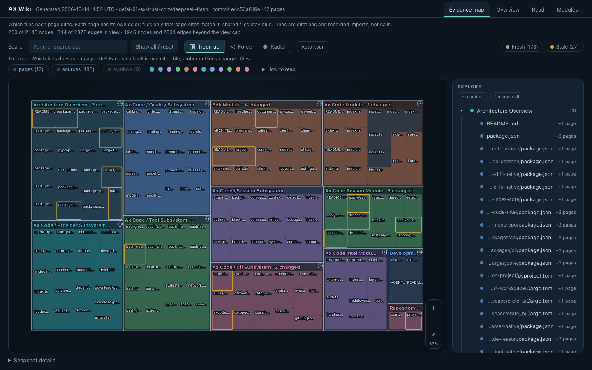
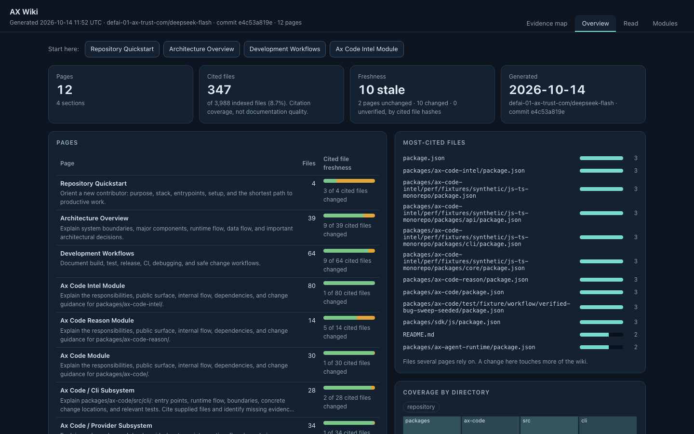

# AX Wiki Viewer

A framework-neutral, browser-safe viewer for recorded Wiki page/source evidence.
No AX Code process, framework peer dependency, CDN, or source-code reader is needed.

```ts
import { mount } from "@ax-code/ax-wiki-viewer"
const view = mount(container, graph)
view.update(nextGraph)
view.dispose()
```

Supply a schema-1 graph from `@ax-code/ax-wiki/graph`. `mount` shows four tabs:

- **Evidence map** (the landing view): pages, the files they cite and recorded imports,
  bounded to 200 nodes and 500 relationships with omissions disclosed. It opens as a
  treemap (one block per page, one equal cell per cited file, changed files outlined);
  Force and Radial show the same evidence as a network. Symbols are hidden until
  enabled or selected.
- **Overview**: start pages, citation coverage against the indexed inventory, per-page
  freshness bars, most-cited files, blind spots (directories with the most uncited
  indexed files, never nested), a `d3-hierarchy` coverage icicle by directory, and a
  page overlap matrix of shared cited files.
- **Read**: page markdown rendered to DOM nodes (no raw HTML, no script or data URLs),
  full-text search, table of contents, related pages by shared citations, and a card
  for each cited path.
- **Modules**: a levelized dependency structure matrix of cited directories with
  cycles outlined, and a page-by-module heatmap.

The reading, overview and module data come from the optional `pages`, `overview` and
`modules` projections (pass page bodies as `documents` to `projectWikiManifest`).
Graphs without them still render the map. `mountMap` mounts only the evidence map.
A new snapshot identity resets selection; invalid updates preserve the previous view.
Hosts can disable style injection with `{ injectStyles: false }` and provide the
exported `viewerCss` themselves.

For a self-contained offline file, Node hosts use `renderWikiGraphHtml(graph)`
from `@ax-code/ax-wiki-viewer/node`. The function returns HTML and its hash-based CSP.
The browser root does not import the Node entrypoint. Data is field-allowlisted;
page text, relative paths and titles can still be sensitive.





An opt-in Auto-tour (off by default, disabled under reduced motion) can cycle the map
layouts while the page is idle; start it from `mount` with
`{ tour: { enabled: true, intervalMs } }` (default 3 minutes).

Build: `pnpm build`. Check generated assets: `pnpm check:bundle`.
Run unit tests: `pnpm test`. Run browser tests after building: `pnpm test:browser`.
Set `AX_WIKI_CHROMIUM` to a Chromium executable when it is not installed at the
Playwright default location. Browser tests exercise offline CSP, hostile labels,
search/filter, keyboard navigation, mobile layout, and instance disposal.
